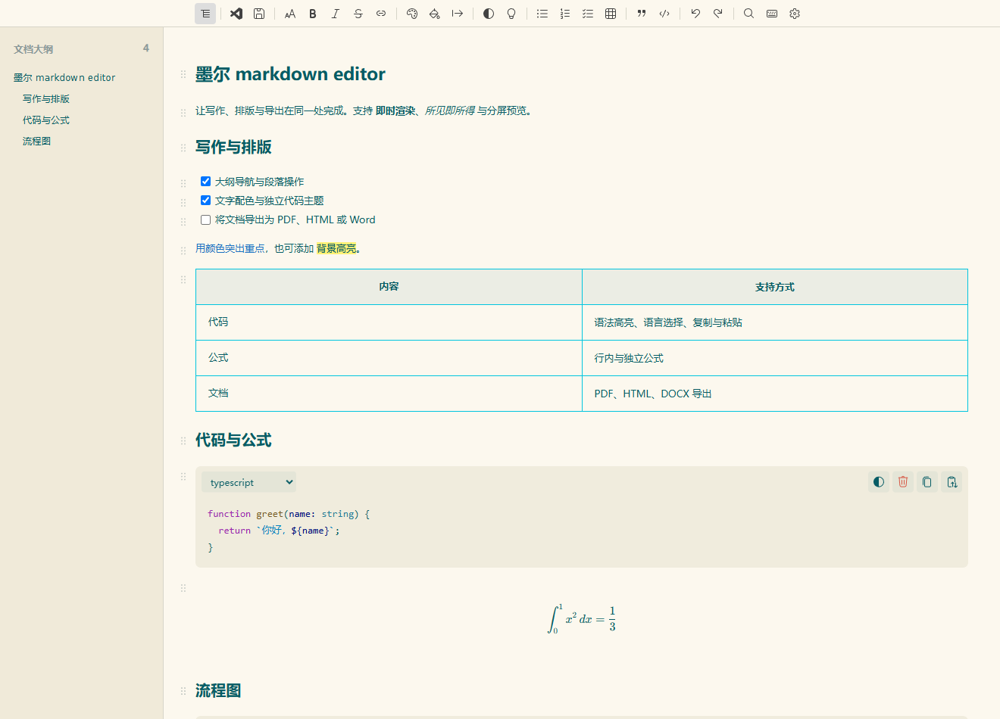
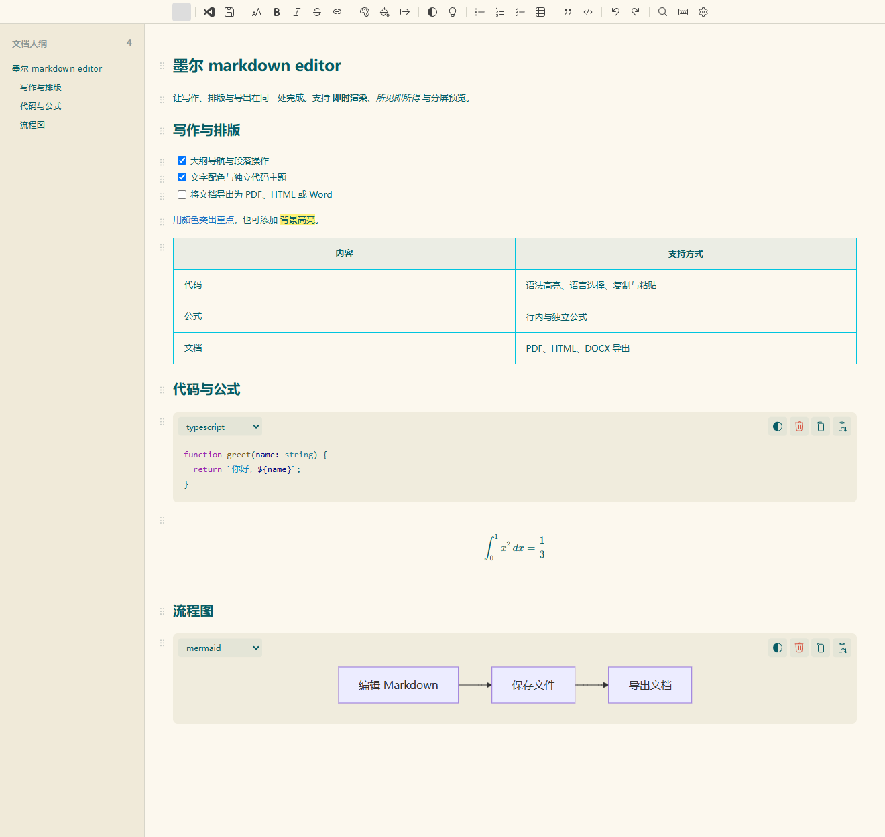
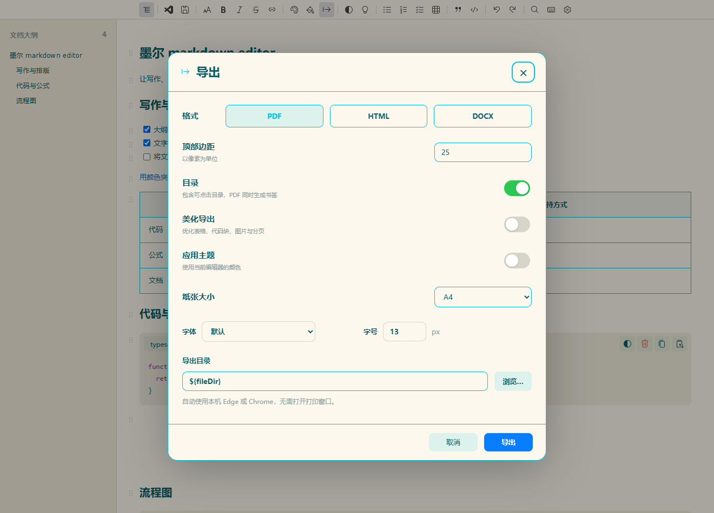

# 墨尔 markdown editor

面向 Windows 桌面版 VS Code 的 Markdown 可视化编辑器。此仓库用于分发安装包、使用说明和收集问题反馈。

## 下载与安装

1. 打开 [最新版本](https://github.com/qycools/moer-markdown-editor/releases/latest)。
2. 在 Assets 中下载 `.vsix` 文件，无需下载 Source code。
3. 在 VS Code 扩展视图右上角的“…”菜单中选择“从 VSIX 安装”。
4. 选择下载的文件，按提示重新加载窗口。

也可在安装包所在文件夹执行：

```powershell
code --install-extension .\moye-markdown-0.1.8.vsix
```

安装后打开 `.md` 或 `.markdown`。若已有其他默认编辑器，右键文件标签页，选择“重新打开方式 → 墨尔 markdown editor”。

更新时下载新版 VSIX，再次安装即可；无需先卸载 `qycools.moye-markdown`。此分发方式需要手动安装后续更新。

## 功能

- 即时渲染、所见即所得、分屏预览。
- 大纲导航、段落操作、文字颜色与背景色、页面宽度设置。
- 代码语言、复制和粘贴，以及独立选择已安装的 VS Code 颜色主题。
- 数学公式、Mermaid 等图表。
- PDF、HTML、DOCX 导出；Word 正文、标题、列表和表格可编辑，公式及复杂图表转为图片。







以上截图来自当前编辑器前端的浏览器测试环境。

## 使用条件

- Windows 桌面版 VS Code 1.95.0 或更新版本。
- 导出需要本机 Edge 或 Chrome，无需安装 Pandoc 或 Word。
- 网页版、macOS、Linux、WSL 和远程扩展宿主尚未纳入本版验收范围。
- 不受信任的工作区中可阅读和编辑，但禁用本机浏览器导出和图片写入。

颜色、字号、分栏和折叠块使用内联 HTML 保存，其他 Markdown 阅读器的显示取决于其 HTML 支持。PlantUML 图表内容会发送至其联网渲染服务；远程图片和媒体会访问各自服务器。

## 校验下载

Release 同时提供 `.sha256` 文件。使用 PowerShell 计算下载包的 SHA-256，与校验文件比较：

```powershell
Get-FileHash .\moye-markdown-0.1.8.vsix -Algorithm SHA256
```

## 问题反馈与许可

请通过本仓库 Issues 提交问题，并附上 VS Code 版本、Windows 版本、复现步骤和不含敏感内容的示例。

许可见 [LICENSE](LICENSE)，第三方组件说明见 [THIRD_PARTY_NOTICES.md](THIRD_PARTY_NOTICES.md)。
